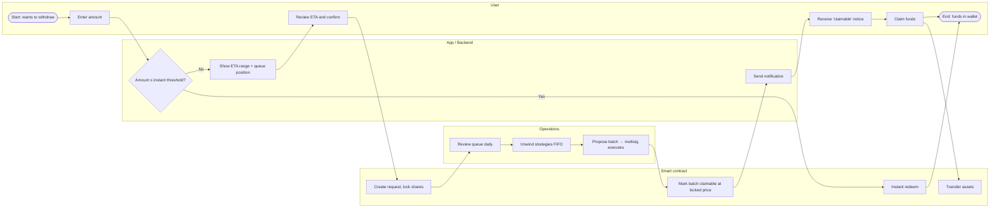
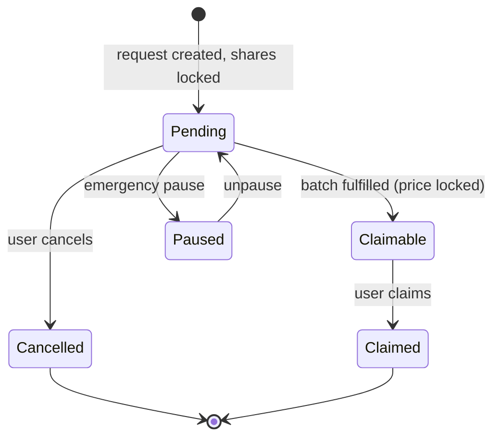

# Process Flow: Queued Withdrawals

BPMN-style swimlane flow. In the specs I deliver, the same flow is drawn in a
BPMN tool; here it is in Mermaid so GitHub renders it.

## Swimlanes: request to claim

## State machine of a request

## Exceptions handled

| Exception | Where | Handling |
|---|---|---|
| Buffer drops between quote and confirm | App → Contract | Contract re-checks; falls back to a request, user sees why |
| ETA exceeded by 48 h | Operations | Support alert + in-app banner (PRD rule 5) |
| Emergency pause | Contract | New requests and fulfilment stop; fulfilled claims stay open |
| User cancels after batch proposed | Contract | Cancel rejected if status ≠ Pending; app explains |
